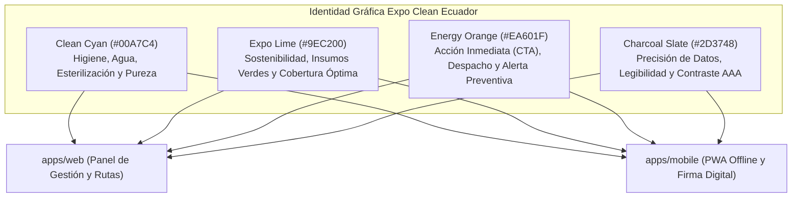

# Sistema de diseño y colores

Fuente canónica de identidad visual, paleta cromática y tokens semánticos de la plataforma IstpetDev para la aplicación web administrativa (`apps/web`) y la aplicación móvil de campo (`apps/mobile`).

> [!NOTE] Fuente oficial de marca
> Esta normativa cromática se extrae directamente de la identidad gráfica oficial del evento **Feria Internacional de Limpieza e Higiene Profesional — Expo Clean Ecuador 2026** (Centro de Exposiciones Quito), armonizada con el **Arquetipo B (Técnico/Minimalista)** ratificado en [[Decisiones de arquitectura|ADR-04]] y los requisitos de accesibilidad [[Requisitos y aceptacion|RNF-09]] (WCAG 2.2 AA).

---

## 1. Fundamento conceptual y semántica de marca

El reto logístico del evento (*Reto 1: Optimización y trazabilidad logística para el abastecimiento de insumos a nivel nacional*) exige una identidad que transmita **asepsia, precisión operativa, sostenibilidad y alta visibilidad en campo**:



1. **Clean Cyan (`#00A7C4` / `primary`):** Representa el agua, la desinfección profesional, la tecnología sanitaria y la trazabilidad transparente. Es el color primario del sistema para barras de navegación, encabezados, estados informativos y elementos interactivos base.
2. **Expo Lime (`#9EC200` / `secondary`):** Tomado del isotipo de remolino dinámico y la franja orgánica del evento. Representa los insumos biodegradables, la eficiencia ecológica y la salud de inventario (*stock en regla*, *lote verificado*).
3. **Energy Orange (`#EA601F` / `accent` / `cta`):** Tomado del botón principal de llamada a la acción y pie institucional del flyer oficial. Aporta máxima saliencia perceptiva para acciones críticas en terminales táctiles (despacho, escaneo QR de unidad logística, firma del receptor) y advertencias de reorden preventivo.
4. **Charcoal Slate (`#2D3748` / `neutral-dark`):** Tipografía institucional con ratio de contraste superior a 7:1 sobre superficies claras, garantizando lectura instantánea de cifras y tablas densas para el jurado.
5. **Superficie Limpia (`#FFFFFF` y `#F8FAFC`):** Espacio en blanco generoso, clínico y sin ruido visual innecesario.

---

## 2. Paleta cromática oficial y escalas tonales

### 2.1 Colores principales (Muestreo colorimétrico del material oficial)

| Token Semántico | Nombre Canónico | Hex Base | RGB | HSL | Rol en la Interfaz |
|---|---|---|---|---|---|
| `clean-cyan` (`primary-500`) | Clean Cyan | `#00A7C4` | `0, 167, 196` | `189°, 100%, 38%` | Marca primaria, navegación, enlaces, estado informativo |
| `expo-lime` (`secondary-500`) | Expo Lime | `#9EC200` | `158, 194, 0` | `71°, 100%, 38%` | Marca secundaria, badges de stock suficiente, éxito |
| `action-orange` (`accent-500`) | Energy Orange | `#EA601F` | `234, 96, 31` | `19°, 83%, 52%` | Botones de acción clave (CTA), escaneo QR, advertencia media |
| `charcoal-slate` (`neutral-800`)| Charcoal Slate| `#2D3748` | `45, 55, 72` | `218°, 23%, 23%` | Tipografía principal, títulos, bordes estructurados |
| `ice-mist` (`neutral-50`) | Ice Mist | `#F8FAFC` | `248, 250, 252`| `210°, 40%, 98%` | Fondos de pantalla, contenedores de métricas |

---

### 2.2 Escalas detalladas para Tailwind CSS v3.4

```javascript
// Definición de escalas cromáticas derivadas de la identidad oficial
const colors = {
  // Primario: Clean Cyan
  'clean-cyan': {
    50: '#E6F7FA',
    100: '#C1EDF3',
    200: '#97E2EC',
    300: '#5CCFE0',
    400: '#26BFD5',
    500: '#00A7C4', // Base oficial
    600: '#008CA5',
    700: '#026E82',
    800: '#085868',
    900: '#0C4956',
    950: '#04303B',
  },
  // Secundario: Expo Lime
  'expo-lime': {
    50: '#F6FBD4',
    100: '#ECF89F',
    200: '#DFF366',
    300: '#CEEC2D',
    400: '#B6DD0D',
    500: '#9EC200', // Base oficial
    600: '#84A300',
    700: '#647B03',
    800: '#4F600A',
    900: '#42510D',
    950: '#222D02',
  },
  // Acento / Acción: Energy Orange
  'action-orange': {
    50: '#FEEFE8',
    100: '#FDDAC8',
    200: '#FAB491',
    300: '#F68953',
    400: '#F16F2C',
    500: '#EA601F', // Base oficial
    600: '#D44F12',
    700: '#B03D0F',
    800: '#8D3213',
    900: '#732B13',
    950: '#3F1306',
  },
  // Neutros Pizarra
  'charcoal': {
    50: '#F8FAFC',
    100: '#F1F5F9',
    200: '#E2E8F0',
    300: '#CBD5E1',
    400: '#94A3B8',
    500: '#64748B',
    600: '#475569',
    700: '#334155',
    800: '#2D3748', // Base tipográfica
    900: '#1E293B',
    950: '#0F172A',
  }
};
```

---

## 3. Matriz semántica de estados logísticos (RNF-09)

En cumplimiento estricto de **RNF-09** (Accesibilidad y comprensión sin dependencia exclusiva del color), los estados operativos se definen con tres niveles indisolubles: **Color + Icono Lucide + Texto de estado unívoco**:

| Estado Logístico | Token Color | Icono Lucide | Texto Mínimo Requerido | Contexto de Aplicación |
|---|---|---|---|---|
| **Saludable / En regla** | `expo-lime-500` / `bg-expo-lime-50 text-expo-lime-700` | `CheckCircle2` | «Stock óptimo (>15 días)» | Hospital abastecido, lote verificado |
| **En tránsito** | `clean-cyan-500` / `bg-clean-cyan-50 text-clean-cyan-700` | `Truck` | «En tránsito (hace X min)» | Unidad logística despachada en ruta |
| **Alerta preventiva** | `action-orange-500` / `bg-action-orange-50 text-action-orange-700`| `AlertTriangle` | «Reorden sugerido (≤5 días)» | Punto próximo a agotar inventario |
| **Riesgo crítico** | `rose-600` (`#DC2626`) / `bg-rose-50 text-rose-700` | `AlertOctagon` | «Crítico: riesgo de rotura» | Punto hospitalario sin cobertura |
| **Guardado en teléfono**| `amber-500` / `bg-amber-50 text-amber-700` | `CloudOff` | «Guardado local; sin red» | Recepción offline en app móvil ([[Decisiones de arquitectura|ADR-17]]) |
| **Aceptado en servidor**| `clean-cyan-600` / `bg-clean-cyan-50 text-clean-cyan-800` | `CloudCheck` | «Sincronizado con servidor» | Idempotencia confirmada en API |

---

## 4. Aplicación en el visor cartográfico ([[Decisiones de arquitectura|ADR-05]])

Para el mapa interactivo Leaflet en `shared/ui/map-view`:
- **Puntos de abastecimiento (Bodegas centrales):** Marcador circular sólido en `clean-cyan-600` con icono blanco de almacén.
- **Puntos receptores en regla (Hospitales/Centros con stock):** Marcador circular en `expo-lime-500`.
- **Puntos receptores con stock crítico:** Marcador con anillo pulsante en `rose-600`.
- **Trazado de Ruta Baseline (Tradicional no optimizada):** Polilínea discontinua en `charcoal-400` (`#94A3B8`).
- **Trazado de Ruta IstpetDev (Optimizada con ventana horaria):** Polilínea continua en `clean-cyan-500` con grosor de 4 px y resplandor suave.

---

## 5. Configuración unificada para `tailwind.config.js`

Tanto `apps/web/tailwind.config.js` como `apps/mobile/tailwind.config.js` implementan esta configuración:

```javascript
/** @type {import('tailwindcss').Config} */
module.exports = {
  content: [
    "./src/**/*.{html,ts}",
  ],
  theme: {
    extend: {
      colors: {
        primary: {
          50: '#E6F7FA',
          100: '#C1EDF3',
          200: '#97E2EC',
          300: '#5CCFE0',
          400: '#26BFD5',
          500: '#00A7C4', // Clean Cyan oficial
          600: '#008CA5',
          700: '#026E82',
          800: '#085868',
          900: '#0C4956',
          950: '#04303B',
        },
        secondary: {
          50: '#F6FBD4',
          100: '#ECF89F',
          200: '#DFF366',
          300: '#CEEC2D',
          400: '#B6DD0D',
          500: '#9EC200', // Expo Lime oficial
          600: '#84A300',
          700: '#647B03',
          800: '#4F600A',
          900: '#42510D',
          950: '#222D02',
        },
        accent: {
          50: '#FEEFE8',
          100: '#FDDAC8',
          200: '#FAB491',
          300: '#F68953',
          400: '#F16F2C',
          500: '#EA601F', // Energy Orange oficial
          600: '#D44F12',
          700: '#B03D0F',
          800: '#8D3213',
          900: '#732B13',
          950: '#3F1306',
        },
        surface: {
          ground: '#F8FAFC',
          card: '#FFFFFF',
          border: '#E2E8F0',
          dark: '#1E293B',
        }
      }
    },
  },
  plugins: [],
}
```

---

## 6. Verificación y cumplimiento de normas

1. **Anti-invención:** Los colores no son arbitrarios; corresponden al flyer oficial de Expo Clean Ecuador 2026.
2. **WCAG 2.2 AA:** Los pares de texto/fondo respetan contraste mínimo de 4.5:1 (ej. texto `primary-700` sobre fondos `primary-50` o texto `#FFFFFF` sobre botones `primary-600` y `accent-600`).
3. **Coherencia Monorepo:** La misma paleta gobierna el panel Angular FSD web y la PWA móvil Ionic.

Documentación vinculada: [[Frontend y componentes]], [[Decisiones de arquitectura]], [[Hechos canonicos]], [[istpetdev-frontend]].
